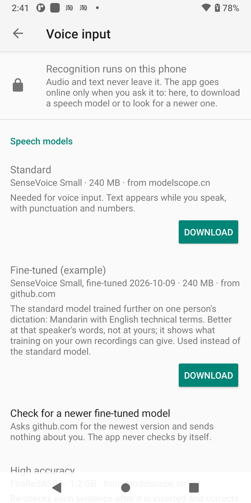
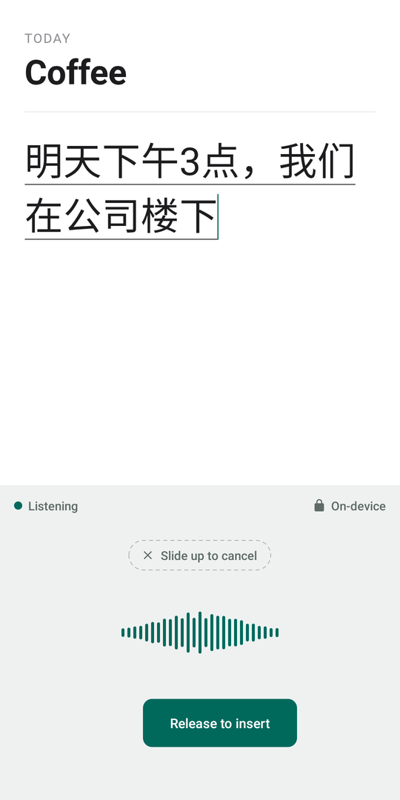

<h1 align="center">Local Voice IME</h1>

<p align="center">
  <b>Speak. It types. Nothing leaves your phone.</b><br>
  A free, open-source Android keyboard with on-device voice dictation<br>
  for Mandarin, English, and both in one sentence.
</p>

<p align="center">
  <a href="https://github.com/Lewin671/local-voice-ime/releases/latest"></a>
  <a href="LICENSE"></a>
  
</p>

<p align="center">
  <a href="https://github.com/Lewin671/local-voice-ime/releases/latest"><b>Download the APK</b></a> ·
  <a href="#get-started-in-three-steps">Get started</a> ·
  <a href="#how-it-stays-private">How it stays private</a> ·
  <a href="#build">Build from source</a>
</p>

https://github.com/user-attachments/assets/06ef0cf0-4aa2-4f6f-9a6b-575425f939cb

<p align="center"><sub>
  Recorded on a Pixel 3, a phone from 2018. The clips run in real time and are not retouched;
  the voice is synthetic and was played into the keyboard's recognizer instead of the microphone.
</sub></p>

## Why this keyboard

- **Private by construction.** Speech is recognized on the phone's CPU. There is no account, no
  cloud API and no telemetry; the app goes online only when you tap a button to download a
  speech model or an update. [Check it yourself](#how-it-stays-private).
- **Talk the way you talk.** Mandarin, English, or both in one sentence, with punctuation and
  numbers written out for you ("三点" → "3点", "fifty" → "50").
- **Works anywhere.** Airplane mode, the subway, a plane: dictation needs no connection.
- **A complete keyboard, not a voice add-on.** 26-key pinyin with sentence-level prediction,
  English with spell check, clipboard history, an iOS-style symbol keyboard, emoji and themes,
  inherited from [fcitx5-android](https://github.com/fcitx5-android/fcitx5-android), which
  this project is a fork of.
- **Free.** No subscription, no quota, no ads.

## Get started in three steps

1. **Install.** Get the APK from [Releases](https://github.com/Lewin671/local-voice-ime/releases/latest),
   open it, and follow the setup screen to enable and select the keyboard.
2. **Download the speech model.** In *Settings → Voice input*, download the standard model
   (240 MB, once) and allow the microphone when asked.
3. **Hold the space bar and talk.** Release to insert the text; slide up to cancel. Or tap the
   microphone in the toolbar and keep talking, hands-free.

| Download the model, once | Hold space and talk | Release: it is typed |
|:---:|:---:|:---:|
|  |  |  |

Requirements: Android 6.0+, arm64. Dictation uses about 0.4 GB of memory while it runs, and the
model is unloaded after a few idle minutes. If Pinyin is missing, add it under *Input Methods*
in the app. Later versions install from *Settings → App update*, when you ask for them.

## Features

- **Hold the space bar to talk**, release to insert the text; slide up to cancel.
- **Hands-free dictation**: tap the microphone in the toolbar and keep talking; each sentence is
  inserted when you pause. The keyboard stays where it is, so punctuation, delete and enter are
  one tap away, and typing a letter turns the microphone off.
- What you say appears in the text field as you say it.
- The microphone turns itself off after 10 seconds of silence; a lock and "On-device" are on
  screen whenever it is on.
- Automatic punctuation and number formatting ("三点" → "3点", "fifty" → "50").
- Mandarin, English and Mandarin–English code-switching (Cantonese, Japanese and Korean are
  understood by the model as well).
- Works fully offline. No account, no telemetry, no cloud API, no cost.
- Dictation is disabled on password fields.
- Optional: text typed on a computer goes into the field you are editing, over USB debugging
  ([docs/ADB_TEXT.md](docs/ADB_TEXT.md)).

## Speech models

The app comes without a speech model, which keeps the APK small. Voice input works once the
standard model has been downloaded in *Settings → Voice input* (240 MB, once); the microphone
button leads there until then. A second, larger model is optional:

| | Standard model | With the high-accuracy model |
|---|---|---|
| Download in *Settings → Voice input* | 240 MB | plus 1.2 GB |
| Memory while dictating | about 0.4 GB | about 1.8 GB |
| Speech model | SenseVoice Small | SenseVoice Small, then FireRedASR2 re-checks every utterance |
| Errors (see [docs/MODELS.md](docs/MODELS.md)) | baseline | about 40–70 % fewer wrong words |

With the high-accuracy model installed the text still appears at once. A few seconds later, words the larger
model heard differently are corrected in place, keeping punctuation and numbers as they were.
Text you have edited in the meantime is never touched. It needs a phone with plenty of memory
(12 GB recommended) and can be switched off, or deleted again, on the same settings screen.

Downloads come from ModelScope ([standard](https://www.modelscope.cn/models/pengzhendong/sherpa-onnx-sense-voice-zh-en-ja-ko-yue),
[high accuracy](https://www.modelscope.cn/models/csukuangfj/FireRedASR2-AED-onnx); reachable
from mainland China), can be paused and resumed, and are verified against checksums fixed in
the app before they are used.

A third download is an example of where this is going: the standard model
[fine-tuned on one person's dictation](https://github.com/Lewin671/sensevoice-finetune), which can be used in place of the standard one.
It knows that person's vocabulary, not yours; it comes from GitHub. It is trained again from
time to time: *Check for a newer fine-tuned model* on the same screen asks GitHub for the
newest version when tapped, and a newer one replaces the one in use once it is downloaded and
verified. The app never looks by itself.

## How it stays private

| Guarantee | How it is enforced |
|---|---|
| Audio and text stay on the phone | No code sends anything. The app's only network code is one file that downloads a speech model or an app update, or asks whether there is a newer one, on request ([`VoiceModelFetch.kt`](app/src/main/java/org/fcitx/fcitx5/android/input/voice/VoiceModelFetch.kt)); `scripts/check-privacy.sh` verifies that for every APK |
| Speech is recognized on the device | [SenseVoice Small](https://github.com/FunAudioLLM/SenseVoice) (and, if downloaded, [FireRedASR2](https://github.com/FireRedTeam/FireRedASR2S)) run on the CPU via [sherpa-onnx](https://github.com/k2-fsa/sherpa-onnx) |
| Downloads cannot be tampered with | Every file of the standard and the high-accuracy model must match a SHA-256 fixed in the app. A newer fine-tuned model and an app update must match the SHA-256 GitHub publishes with their release; Android installs an update only if it is signed like the installed app |
| Audio is not stored unless you ask for it | Samples live in memory for the utterance in progress only. Keeping recordings, to fine-tune a model on your own speech, is a switch that is off until you turn it on; they stay on the phone until you export or delete them ([docs/PRIVACY.md](docs/PRIVACY.md)) |

Details: [docs/PRIVACY.md](docs/PRIVACY.md).

## Build

Prerequisites:

- JDK 17 or 21
- Android SDK with Platform 36, Build-Tools 36.1.0, NDK 28.0.13004108 and CMake 3.31.6
  (`sdkmanager "platforms;android-36" "build-tools;36.1.0" "ndk;28.0.13004108" "cmake;3.31.6"`)
- `extra-cmake-modules` and `gettext`
  (macOS: `brew install extra-cmake-modules gettext`; Debian/Ubuntu: `apt install extra-cmake-modules gettext`)

```sh
git clone --recurse-submodules https://github.com/Lewin671/local-voice-ime.git
cd local-voice-ime
./scripts/build.sh            # downloads the speech runtime (~60 MB) on first run, prints the APK path
./scripts/check-privacy.sh    # verifies that network use is limited to model downloads
adb install -r <path printed by build.sh>
```

`./scripts/build.sh release` produces an optimized build; see [docs/TESTING.md](docs/TESTING.md)
for signing.

## Roadmap

- Benchmarks on real phones (load time, real-time factor, memory); see `docs/MODELS.md`.
- A speech model that knows the user's names and technical terms (the models tend to mis-spell
  English jargon inside Chinese sentences). Hot word lists were measured and do not get there
  (`docs/MODELS.md`); the way forward is fine-tuning on one's own speech, for which the app can
  keep recordings on request (`docs/TRAINING_DATA.md`) and
  [sensevoice-finetune](https://github.com/Lewin671/sensevoice-finetune) trains on an export of them. One model made that way can be
  downloaded in the settings as an example, and updated there when it is trained again; importing a model of one's own is still to come.
- Enable Pinyin by default regardless of the system language.

## Documentation

- [AGENTS.md](AGENTS.md) — start here if you (or your AI coding agent) want to work on the code
- [docs/ARCHITECTURE.md](docs/ARCHITECTURE.md) — how voice input is wired into the keyboard
- [docs/MODELS.md](docs/MODELS.md) — model choice, benchmark numbers, how to evaluate another model
- [CONTRIBUTING.md](CONTRIBUTING.md) — workflow and rules for changes
- [docs/design/](docs/design/DESIGN.md) — design spec and mockup of the keyboard and dictation UI
- [docs/TESTING.md](docs/TESTING.md) — unit tests, automated end-to-end test, release builds
- [docs/PERFORMANCE.md](docs/PERFORMANCE.md) — performance bottlenecks, energy optimizations, measurement limits
- [docs/PRIVACY.md](docs/PRIVACY.md) — privacy policy
- [docs/DIAGNOSTICS.md](docs/DIAGNOSTICS.md) — finding out why dictation stopped: the journal kept on request, and its export
- [docs/TRAINING_DATA.md](docs/TRAINING_DATA.md) — keeping recordings to fine-tune a model, and the export format
- [docs/ADB_TEXT.md](docs/ADB_TEXT.md) — typing text from a computer over adb
- [NOTICE.md](NOTICE.md) — relationship to upstream, changes, third-party licenses
- [docs/UPSTREAM_README.md](docs/UPSTREAM_README.md) — the original fcitx5-android README

## Credits and license

Local Voice IME is a fork of fcitx5-android. It is an independent project, not affiliated with
or endorsed by the Fcitx project. What was changed, and the licenses of everything bundled, are
listed in [NOTICE.md](NOTICE.md).

- [fcitx5-android](https://github.com/fcitx5-android/fcitx5-android) and the Fcitx5 project —
  the keyboard and input method engines
- [sherpa-onnx](https://github.com/k2-fsa/sherpa-onnx) (Apache-2.0) — speech inference runtime
- [SenseVoice](https://github.com/FunAudioLLM/SenseVoice) — speech recognition model
- [FireRedASR2](https://github.com/FireRedTeam/FireRedASR2S) (Apache-2.0) — the optional high-accuracy model
- [Silero VAD](https://github.com/snakers4/silero-vad) (MIT) — voice activity detection

Licensed under [LGPL-2.1-or-later](LICENSE), like upstream. The speech models
are distributed under their own licenses; see the links above.
